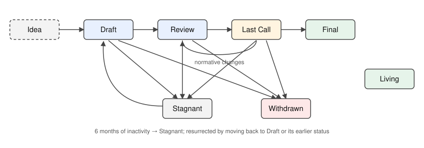

## What is an SIP?

**SIP** means **Sila Improvement Proposal**. A SIP states a Sila-native feature, governance procedure, protocol change, or interoperability rule in a form that can be reviewed, implemented, and tested independently. SIPs belong to Sila Network and must not assert compatibility aliases, identities, forks, networks, or releases from another protocol.

**Sila Network (@sila-network)** is the exclusive issuing authority for Sila SIP documents. Public contributions may be reviewed by authorized Sila editors, but the issuer field remains Sila Network. Proposal publication is distinct from Sila implementation, approval, or activation.

## SIP Rationale

SIPs provide a single Sila-controlled mechanism to specify and validate changes to Sila clients, Sila networking, Sila interfaces, and Sila applications. The mechanism must not assume an implementation exists before its actual Sila version and test evidence have been checked.

A SIP is never proof of activation. Any proposed change to Sila network behavior requires a separate, genuine Sila governance and implementation decision.

## SIP Types

There are three proposal types:

- **Standards Track** specifies interoperable behavior and must be accompanied by sufficient implementation and conformance evidence. Its categories are:
  - **Core**: Sila execution, state transition, consensus, upgrades, and rules affecting multiple clients.
  - **Networking**: Sila peer-to-peer and wire-protocol interoperability.
  - **Interface**: Sila APIs, contract interfaces, and application interoperability.
  - **SRC**: Sila-native application, token, wallet, and contract standards. A cross-reference or routing page is not an approved SRC specification.
- **Meta** describes binding Sila governance, review, and development procedures.
- **Informational** conveys technical guidance without declaring a protocol change.

Each SIP should address one independently reviewable change. A purely local implementation adjustment need not become a network standard.

### Special requirements for Core SIPs

A SIP modifying the **Sila Virtual Machine (SVM)** must identify verified Sila instructions, numeric opcodes, stack behavior, gas behavior, error cases, and conformance tests. The name `SVM` denotes the intended Sila-native identity only; it does not establish that an unrelated tool, runtime, or interface is interchangeable. Actual instruction and runtime names require verification from a Sila-controlled implementation.

## SIP Work Flow

### Shepherding an SIP

Contributors present technical ideas to the Sila community through [Sila Magicians](https://sila-magicians.discourse.group/) and can submit proposals to [Sila SIPs](https://github.com/sila-network/SIPs/pulls). Authorized Sila editors verify structure, security considerations, Sila-only identity, normative dependencies, and technical feasibility. The sole document issuer remains Sila Network.

### Core SIPs

A Core SIP requires executable Sila-native test vectors, verified implementation compatibility, explicit security review, and a genuine Sila network activation decision where applicable. A similarly named feature elsewhere does not establish Sila implementation or adoption.

### SIP Process

**Idea** - An unnumbered, unratified concept.

**Draft** - An assigned candidate proposal; it is not active.

**Review** - A candidate under technical and governance review.

**Last Call** - A proposal entering a verifiable, time-limited final review. Actual dates must be provided; an invented deadline is prohibited.

**Final** - A Sila governance-approved specification. Final status alone does not establish deployment or activation.

**Stagnant** - A proposal paused for lack of progress.

**Withdrawn** - A proposal withdrawn from consideration; its number is not reassigned.

**Living** - A continually maintained process document, including SIP-1.

Normative corrections during Last Call require renewed review. Material changes to Final specifications must be made through a distinct SIP. Editors cannot assign a false status, imply a nonexistent network upgrade, or approve an unresolved dependency.

## What belongs in a successful SIP?

Each SIP should have the following parts:

- Preamble - RFC 822 style headers containing metadata about the SIP, including the SIP number, a short descriptive title (limited to a maximum of 44 characters), a description (limited to a maximum of 140 characters), and the author details. Irrespective of the category, the title and description should not include SIP number. See [below](./sip-1.md#sip-header-preamble) for details.
- Abstract - Abstract is a multi-sentence (short paragraph) technical summary. This should be a very terse and human-readable version of the specification section. Someone should be able to read only the abstract to get the gist of what this specification does.
- Motivation *(optional)* - A motivation section is critical for SIPs that want to change the Sila protocol. It should clearly explain why the existing protocol specification is inadequate to address the problem that the SIP solves. This section may be omitted if the motivation is evident.
- Specification - The technical specification should describe the syntax and semantics of any new feature. The specification should be detailed enough to allow competing, interoperable implementations for any of the current Sila client implementations.
- Rationale - The rationale fleshes out the specification by describing what motivated the design and why particular design decisions were made. It should describe alternate designs that were considered and related work, e.g., how the feature is supported in other languages. The rationale should discuss important objections or concerns raised during the discussion around the SIP.
- Backwards Compatibility *(optional)* - All SIPs that introduce backwards incompatibilities must include a section describing these incompatibilities and their consequences. The SIP must explain how the author proposes to deal with these incompatibilities. This section may be omitted if the proposal does not introduce any backward incompatibilities, but this section must be included if backward incompatibilities exist.
- Test Cases *(optional)* - Test cases for an implementation are mandatory for SIPs that are affecting consensus changes. Tests should either be inlined in the SIP as data (such as input/expected output pairs) or included in `../assets/sip-###/<filename>`. This section may be omitted for non-Core proposals.
- Reference Implementation *(optional)* - An optional section that contains a reference/example implementation that people can use to assist in understanding or implementing this specification. This section may be omitted for all SIPs.
- Security Considerations - All SIPs must contain a section that discusses the security implications/considerations relevant to the proposed change. Include information that might be important for security discussions, surfaces risks and can be used throughout the life-cycle of the proposal. E.g., include security-relevant design decisions, concerns, important discussions, implementation-specific guidance and pitfalls, an outline of threats and risks and how they are being addressed. SIP submissions missing the "Security Considerations" section will be rejected. An SIP cannot proceed to status "Final" without a Security Considerations discussion deemed sufficient by the reviewers.
- Copyright Waiver - All SIPs must be in the public domain. The copyright waiver MUST link to the license file and use the following wording: `Copyright and related rights waived via [CC0](../LICENSE.md).`

## SIP Formats and Templates

SIPs should be written in [markdown](https://github.com/adam-p/markdown-here/wiki/Markdown-Cheatsheet) format. There is a [template](../sip-template.md) to follow.

## SIP Header Preamble

Every SIP uses a YAML front matter block delimited by three hyphens. The normative fields appear in this order:

`sip`: *A real Sila SIP number assigned by an authorized editor.*

`title`: *The short Sila-native title.*

`description`: *A concise statement of the proposed Sila behavior.*

`author`: *Always `Sila Network (@sila-network)` as sole issuer.*

`discussions-to`: *An actual Sila Magicians discussion topic when one exists.*

`status`: *Draft, Review, Last Call, Final, Stagnant, Withdrawn, or Living.*

`last-call-deadline`: *The real deadline, for Last Call proposals only.*

`type`: *Standards Track, Meta, or Informational.*

`category`: *Core, Networking, Interface, or SRC for Standards Track.*

`created`: *The true date the Sila proposal number was assigned.*

`requires`: *Real Sila SIP dependencies, when required.*

`withdrawal-reason`: *Required for Withdrawn proposals only.*

Date values use ISO 8601 (`yyyy-mm-dd`). No fictitious topic, date, authorship, client release, activation, or dependency may be entered to satisfy a linter. A candidate missing mandatory verified evidence is blocked from ratification.

### `author` header

`Sila Network (@sila-network)` is the sole issuer. A reviewer's GitHub account is not a second publisher or an alternative protocol identity.

### `discussions-to` header

Use the real, existing discussion-topic URL at [Sila Magicians](https://sila-magicians.discourse.group/). A generic forum home page or pull request must not be invented as a completed proposal discussion.

### `type` header

Select the normative proposal type according to whether it changes technical rules, governance, or only offers guidance.

### `category` header

Every Standards Track document must declare its correct Sila category. A routing document is not a deployed standard.

### `created` header

Use an actual Sila issuance date; do not substitute dates from unrelated source material.

### `requires` header

A normative dependency must resolve to an existing Sila-owned authoritative specification. If the dependency is absent or unverified, mark the document blocked; do not create a fake placeholder, alias, or compatibility interface.

## Linking to External Resources

Sila normative references must resolve to genuine **Sila-controlled** code, specifications, or decisions. A cross-network implementation is not Sila evidence. Pin normative code citations to verified immutable revisions, not mutable branches. Where a required Sila counterpart is not verified, the issue is a **BLOCKER**, not a reason to invent a repository or alias.

### Sila Execution Specifications

Cite Sila-controlled execution rules, verified revision identifiers, and Sila conformance tests. No specific repository location is claimed without verification.

### Sila System Contract Implementations

A system-contract reference requires a real Sila-owned implementation and passing Sila tests. Do not claim that a contract exists merely because an analogous component exists elsewhere.

### Sila Consensus Specifications

Cite actual Sila consensus rules, validators, state-transition tests, and supported upgrade definitions. A Sila activation must be supported by Sila-native evidence.

### Sila Networking Specifications

Sila peer and wire-protocol references must use Sila-native names, message schemas, and versions verified against Sila components.

### Sila Portal Specifications

A Sila Portal reference requires independently verified Sila ownership and an implemented Sila protocol. This heading does not declare such a component deployed.

### Sila Formal Protocol Specification

Cite only a published and independently verifiable Sila formal specification when one exists. No document from another network can act as a substitute.

### Sila Execution API Specification

Sila APIs must have Sila-owned method and namespace identities. A required external wire interface without a proven Sila counterpart is a blocker and does not authorize an alias.

### Independent International Standards

Independent specifications such as W3C, WHATWG, published IETF RFCs, Unicode UTS, and recognized public vulnerability catalog entries may be cited solely for neutral technical formats or safety requirements. These references do not become Sila protocol authorities. Use an immutable or specifically identified revision.

### Digital Object Identifiers

A DOI reference identifies an actual publication and must resolve to an accessible source. Documentation examples must not be misrepresented as Sila implementation evidence.

### Other Blockchain Specifications

Do not insert a foreign blockchain identifier, operational name, client, network history, token standard, or fork identity. External cross-network references cannot authorize Sila functionality or bypass verification.

## Linking to other SIPs

A real Sila improvement proposal is referenced as `SIP-N`; a verified Sila application standard is referenced as `SRC-N`. Link to existing local Sila documents using relative paths, for example [SIP-1](./sip-1.md). A missing target or routing-only page cannot satisfy a normative dependency.

## Auxiliary Files

Sila diagrams, supporting tests, and images must use `assets/sip-N/` paths and Sila-controlled identities. References must resolve to existing files. Do not add source snapshots, migration archives, historical registers, or legacy identity catalogs.

## SIP Stewardship

Sila Network owns the authority to issue and approve SIPs. Maintenance tasks may be reassigned to a currently authorized editor without introducing an alternative SIP issuer. Such reassignment cannot change the genuine technical readiness or approval status of a proposal.

## SIP Governance

**Sila Network (@sila-network)** is the sole SIP publication authority. The authorized individual account `@sila-chain` is an editor listed in the current repository configuration, not a separate network or alternative issuer.

Sila Network establishes the governance process, appoints editors, and authorizes technical inclusion of verified Core proposals in Sila upgrades. No editor may claim an implementation, activation, or approval absent verified Sila evidence.

The authorized [Sila SIP repository](https://github.com/sila-network/SIPs) contains proposed specifications, while [Sila Magicians](https://sila-magicians.discourse.group/) hosts technical discussion. Public review does not itself ratify a network change.

## SIP Editors

The currently designated editor account is `@sila-chain`, as reflected in [`config/sip-editors.yml`](../config/sip-editors.yml). The document issuer remains `Sila Network (@sila-network)` irrespective of the editor handling a proposal.

## SIP Editor Responsibilities

Editors must:

- Confirm that the specification uses Sila-only operational identity and approved Sila authorities.
- Review the proposal for clear normative semantics, technical soundness, a Sila-native title, and correct Markdown.
- Verify genuine Sila implementation evidence, conformance tests, security requirements, and dependencies.
- Refuse fictional Sila revisions, unsupported activation claims, foreign compatibility names, and missing normative targets.
- Ensure that `Sila Network (@sila-network)` remains the sole issuer in every normative SIP document.
- Require genuine approval before marking Final or releasing a new Sila network rule.
- Merge approved changes only through the authorized [Sila SIP review process](https://github.com/sila-network/SIPs/pulls).

Editors cannot waive the Pure Sila identity policy or replace real tests with terminology changes.

## Style Guide

### Titles

The `title` field in the preamble:

- Should be in title case.
- Should not include the word "standard" or any variation thereof; and
- Should not include the SIP's number.

### Descriptions

The `description` field in the preamble:

- Should be in sentence case.
- Should not include the word "standard" or any variation thereof; and
- Should not include the SIP's number.

### SIP numbers

When referring to an SIP with a `category` of `SRC`, it must be written in the hyphenated form `SRC-X` where `X` is that SIP's assigned number. When referring to SIPs with any other `category`, it must be written in the hyphenated form `SIP-X` where `X` is that SIP's assigned number.

### RFC 2119 and RFC 8174

SIPs are encouraged to follow [RFC 2119](https://www.rfc-editor.org/rfc/rfc2119) and [RFC 8174](https://www.rfc-editor.org/rfc/rfc8174) for terminology and to insert the following at the beginning of the Specification section:

> The key words "MUST", "MUST NOT", "REQUIRED", "SHALL", "SHALL NOT", "SHOULD", "SHOULD NOT", "RECOMMENDED", "NOT RECOMMENDED", "MAY", and "OPTIONAL" in this document are to be interpreted as described in RFC 2119 and RFC 8174.

Don't use RFC 2119 keywords (all-caps SHOULD/MUST/etc.) outside of the specification section.

## Copyright

Copyright and related rights waived via [CC0](../LICENSE.md).
