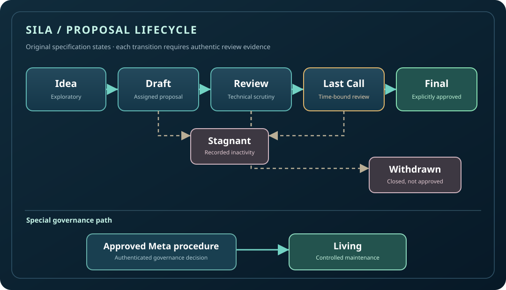

## Abstract

SIP-1 specifies a new, Sila-owned procedure for proposing, reviewing, approving, and publishing protocol and governance specifications. It defines a single set of document requirements, participants, states, and evidence gates. Every proposal starts as an unapproved Sila candidate. A successful document build is never evidence of a network change, an existing implementation, or governance adoption.

This document is itself a **Draft**. Its publication as a proposal does not mean the proposed procedure has already been approved or used.

## Motivation

Sila needs a repeatable way to describe changes without creating unsupported claims about network behavior, deployment, prior decisions, or component ownership. The process must separate five distinct activities: writing a proposal, confirming that it is technically coherent, reviewing the proposal, recording an authorized Sila decision, and activating an implementation when activation is required.

Sila specifications must stand on their own. Formats and neutral public standards may be referenced as external standards, but the operating identity of the protocol, software, network, and governance remains Sila.

## Specification

### Terms and governing principles

In this document, **MUST** means a mandatory requirement, **MUST NOT** means a prohibition, **SHOULD** means a recommended requirement that needs a documented reason to depart from, and **MAY** means an option.

- **SIP** is an independently written Sila Improvement Proposal. A SIP is a specification candidate until Sila grants it an appropriate governance status.
- **Sila Network** is the sole publication authority for this proposal collection. Publication authority is not a substitute for a recorded governance decision.
- **SRC** denotes a Sila application or contract standard, with separate substantive validation. A routing reference is not an implementation or approved standard.
- **Sila-native evidence** means an existing Sila-owned specification, source revision, executable conformance result, or documented organizational decision whose ownership and validity can be checked.
- **Normative** means required to interpret or implement a proposal. An illustrative example does not itself create network rules.

A SIP MUST describe only Sila protocol, governance, and application identities as Sila-owned operational entities. It MUST NOT introduce a foreign protocol's operational namespace, compatibility alias, inherited network identifier, or invented counterpart. If an interface or implementation needed by a proposal has no verified Sila counterpart, review MUST stop at a clearly described blocker. Independent formats, standards, and general-purpose development tools retain their own identities.

### Participants and responsibility

- **Publication authority:** Sila Network controls the official SIP repository, proposal numbering, publication decisions, and authorization of governance roles.
- **Founding authors:** Ahmed Ibrahim and Jihad Mustafa are the named authors for SIP-1. At the foundation stage, the author registry in the Sila configuration permits these two authors; expanding it requires a separately authorized Sila decision. Authorship MUST represent the actual authors of a document.
- **Proposer:** A person suggesting a change MAY prepare a candidate or give feedback, but proposing an idea does not confer an author byline, editor privileges, or authority to declare consensus.
- **Editor:** An editor authorized by Sila Network checks document structure, numbering, completeness, valid references, and state-transition evidence. The role describes a function; this document does not claim that appointments have already occurred.
- **Technical reviewer:** A reviewer assesses normative behavior, testability, implementation feasibility, and risk. A Standards Track proposal SHOULD receive review independent of the document's authors.
- **Implementer:** An implementer provides code and test evidence for the affected Sila components. Implementation evidence does not grant governance approval.
- **Final decision authority:** Ahmed Ibrahim alone has the Sila project owner's final authority to approve or reject changes across Sila-owned repositories. The GitHub account designated for his decisions in this repository is `sila-chain`. This designation does not approve SIP-1 or any other proposal, nor does it by itself make a repository change effective.
- **Independent technical reviewer:** An authorized reviewer independent of the change author MUST complete the required technical review before any merge. That reviewer MAY recommend approval or rejection but MUST NOT replace the final decision by Ahmed Ibrahim. In particular, when `sila-chain` authors a change, that account MUST NOT be treated as its own independent reviewer.
- **Decision evidence:** A final owner decision MUST identify the actual Sila change and its exact revision. A test result, an author's signature, a reviewer recommendation, a saved preference, or a successful build MUST NOT be mistaken for an owner approval. GitHub branch rules and access controls MUST enforce the applicable requirements before integration.

No bot or automated test has the authority to approve a specification, invent a human sign-off, or activate a network change. Reviewers and editors MUST disclose a material conflict of interest and seek independent review when appropriate.

### Proposal classes

The three document types are:

- **Standards Track:** A normative change affecting the Sila protocol, networking, interfaces, or application standards. It MUST declare exactly one category.
- **Meta:** A proposal about Sila processes, editorial rules, or governance procedures. It MUST NOT declare a Standards Track category.
- **Informational:** Explanatory guidance or analysis. It MUST NOT impose new normative network behavior or claim to be an activated rule.

Standards Track categories are:

- **Core:** Execution rules, state transitions, consensus behavior, protocol upgrades, and system-level rules.
- **Networking:** Sila peer discovery, transport, message framing, and network interaction.
- **Interface:** Sila client APIs, wallet interfaces, contract interaction formats, and other external integration contracts.
- **SRC:** Sila application, token, wallet, and contract standards. A SIP in this category MUST NOT pretend that an SRC specification, implementation, or adoption exists without verifiable evidence.

An author MUST NOT use a different type merely to avoid security, implementation, or conformance requirements. Cross-category effects MUST be addressed in the same specification or linked to real Sila proposals.

### Proposal numbering and files

Sila Network assigns a unique positive decimal number before a numbered proposal is published. The number is never inherited from another network or inferred from a similar technical subject. Draft candidates without an assigned number remain unnumbered working material and MUST NOT be published as approved SIPs.

A numbered SIP is stored at `SIPS/sip-N.md`, where N is its assigned positive decimal number. SIP numbers are immutable once published; they are not reused or transferred to another specification. A replacement design receives a new number and links back only to genuine Sila documents.

An editor MUST reject duplicate numbers, conflicting filenames, misleading title prefixes, or invented sibling documents. Cross-references MUST resolve to an actual Sila-owned document and not merely a plausible number.

### Required metadata and optional fields

Every numbered SIP MUST start with a single flat metadata block between `---` delimiters. The required fields are:

- `sip`: the assigned positive integer matching the file name.
- `title`: an accurate, concise Sila-native document name, at most 44 characters, without repeating its SIP number.
- `description`: a short sentence summarizing the proposal, at most 140 characters.
- `author`: the real, Sila-authorized named author or authors.
- `status`: one of the defined Sila process states.
- `type`: Standards Track, Meta, or Informational.
- `created`: the true proposal creation date in ISO calendar form.

The additional fields have strict meanings:

- `category` is required only for Standards Track and MUST be Core, Networking, Interface, or SRC.
- `requires` lists genuine existing Sila SIP numbers in ascending order that are normative dependencies. Self-references and references to missing SIPs are invalid. Dependencies MUST be at least as mature as the referencing SIP; a withdrawn proposal cannot be used as a normative dependency.
- `discussions-to` is an actual existing Sila community discussion URL, not a forum home page, an invented thread, or a link imported from elsewhere.
- `last-call-deadline` is mandatory for Last Call and must identify the real end of the review interval.
- `withdrawal-reason` is mandatory for Withdrawn.
- `approval-ref` identifies an immutable, verifiable Sila decision record and is mandatory for Final and approved Living.
- `implementation-ref` may identify a pinned Sila source revision or conformance record; a link alone is not proof that all technical tests passed.

Metadata keys MUST appear in the published Sila front-matter order. A reference to
a Sila implementation MUST identify a specific immutable source revision,
not a mutable development branch or an unverified repository home page.
An external independent technical standard MAY be linked only by a
versioned reference permitted by Sila's original validator rules.
Passing a URL format check does not verify that the remote resource exists.

The Sila proposal title and description MUST be concise, without colon separators. In a Standards Track proposal, an explicit SIP reference within the Specification denotes a normative dependency and MUST appear in the `requires` metadata. Inline code examples do not create normative references.

The first prose citation of a different Sila proposal MUST link to that
proposal's actual numbered Sila source. A cited Sila proposal MUST be at
least as mature as the citing proposal. A Withdrawn proposal is not a
valid normative dependency or stable reference; illustrative inline
code does not count as an actual citation.

Sila prose MUST cite numbered proposals as `SIP-N` with a canonical
positive number. Malformed headings and HTML comments are not allowed in
normative source text; code samples are distinguished from actual prose.
Titles and descriptions MUST each have at least two characters.

A metadata key MUST NOT be populated merely to satisfy a validator. A false author, date, discussion link, approval, or implementation reference is a substantive governance error. Dates in example templates are placeholders, never events. Fields not relevant to a proposal SHOULD be absent instead of carrying fictitious values.

### Document sections and submission contract

Every normative proposal MUST include the following sections in order: Abstract, Specification, Rationale, Security Considerations, and Copyright. Optional top-level sections MUST follow the canonical Sila sequence: Abstract, Motivation, Specification, Rationale, Backwards Compatibility, Migration, Rollback Plan, Test Cases, Reference Implementation, Security Considerations, Copyright. Duplicate or unrecognized top-level sections are invalid. The Abstract states what is proposed without claiming that it is already installed.

A Standards Track Specification MUST define affected Sila components, inputs and outputs, normative algorithms or state changes, valid and invalid conditions, and any numerical values or wire formats needed for two independent implementations to agree. The proposal MUST identify security-sensitive assumptions, dependencies, deployment prerequisites, and measurable acceptance conditions.

A Core SIP that changes execution, consensus, state, gas accounting, or the Sila Virtual Machine MUST define precise behavior, error cases, invariants, and executable Sila-native conformance cases before Final can be considered. Merely matching terminology used elsewhere is not proof of a Sila implementation.

Supporting assets MUST be original to the repository or otherwise legitimately authorized and appropriate for publication. Original figures and diagrams MUST be checked as project assets; the absence of an asset is not a reason to import someone else's diagram.

### Process states

There are eight allowed statuses. Status records the editorial and governance state of a Sila document, not the runtime status of the Sila network.

- **Idea:** A documented subject not yet ready for formal technical review. An Idea MUST NOT claim network acceptance.
- **Draft:** An assigned, editable proposal with the minimum metadata and required sections.
- **Review:** An editor has accepted the document as ready for substantive technical examination; this does not approve its contents.
- **Last Call:** A time-bounded final opportunity to inspect a substantially stable candidate.
- **Final:** An explicitly approved Sila specification with a verified approval reference. This status by itself does not prove implementation or activation.
- **Stagnant:** A previously active candidate that is not progressing. An editor must document the actual cause before marking this state.
- **Withdrawn:** A proposal closed with an accurate withdrawal reason. It is not an approved standard.
- **Living:** An approved Sila governance or process document maintained through controlled editorial updates. It requires the same real decision evidence as Final.

The permitted ordinary progression is described below. Each arrow names a possible procedure, not an event that has already occurred:



The original Sila diagram and the text-only process specification describe possible states, not historical Sila approvals.

```text
Idea --> Draft --> Review --> Last Call --> Final
           ^         |            |
           +---------+------------+
           |                      |
           +------ Stagnant ------+
           |
           +-- resubmission after actual review

Idea / Draft / Review / Last Call / Stagnant --> Withdrawn

Approved Meta process proposal --> Living
```

### Transition rules and evidence

- **Idea to Draft:** A Sila editor assigns an unused number, verifies the author's authorization, and checks minimum document structure.
- **Draft to Review:** The author requests technical review; an editor confirms that scope, normative dependencies, initial security considerations, and outstanding blockers are disclosed.
- **Review to Draft:** A material technical redesign requires a revised candidate and another review cycle.
- **Review to Last Call:** A qualified review confirms that the specification is coherent and the remaining public review questions are identified. A fixed future deadline and real discussion location must be recorded before Last Call begins.
- **Last Call to Review:** A normative correction or unresolved technical objection returns the document to Review with an updated candidate. The previous deadline does not count as approval.
- **Last Call to Final:** The deadline has elapsed, material objections have been addressed, independent technical evidence is available for the proposal type, and an authorized Sila decision is recorded with an immutable reference. A failing or unverified dependency blocks this transition.
- **Draft, Review, or Last Call to Stagnant:** An authorized editor records genuine inactivity or a durable blocker. No state may be assigned from an invented inactivity date. A Stagnant proposal may return to Draft only after a real author-led resumption and editorial recheck.
- **Nonfinal state to Withdrawn:** A real author withdrawal or authorized governance closure must provide a reason. Withdrawn is terminal for the assigned document; a new design uses a new proposal number.
- **Approved Meta to Living:** A real governance decision allows ongoing maintenance. A Draft Meta proposal, including this SIP-1, MUST NOT be called Living solely because it describes a process.
- **Final or Living changes:** Purely editorial corrections require documented verification that semantics are unchanged. Any new rule, security consequence, or protocol behavior requires a separately numbered SIP and its own decision.

No workflow bot may change a document into Final or Living merely because automated tests pass.

### Technical review and Last Call

Reviewers must check meaning, compatibility with genuine Sila components, implementation impact, backwards compatibility where relevant, test coverage, denial-of-service risk, and specification ambiguity. Comments must be anchored to the actual candidate revision.

Last Call SHOULD remain open for at least fourteen full calendar days after a complete candidate and real public review location are available. An editor MUST set a genuine deadline before starting Last Call, and unresolved normative changes MUST restart review. There is no automatic promotion when the deadline expires.

Ahmed Ibrahim is designated as the exclusive final decision owner for Sila-owned repository changes, with `sila-chain` as his GitHub account in this repository. Independent technical review remains mandatory before merging. A real owner decision bound to the exact source revision, a completed independent review, and verifiable governance evidence are still required before Final or approved Living may be granted. This document does not invent a voting quorum, an earlier consensus, or a meeting that has not happened. This draft does not claim that automated enforcement has been configured for every future Sila repository.

### Adoption and activation are separate

A Final SIP is a governance-approved specification only. For a proposal changing network behavior, activation requires a separate verified Sila implementation set, conformance tests, security assessment where appropriate, upgrade coordination, and a real Sila activation decision.

A website page, commit, CI success, or comparable feature in another protocol MUST NOT be used as evidence of deployment. The publication pipeline MUST keep the distinction between Draft, approval, implementation, and activation visible to readers.

### Editorial maintenance and author responsibilities

Editors may correct typos, formatting, harmless link presentation, and invalid metadata after confirming that the intended specification has not changed. A substantive change requires author review and a new technical review cycle. Editors MUST NOT silently change authors, states, decisions, or numeric behavior.

Authors are responsible for ensuring that content is original to Sila and that all included technical claims and diagrams are supportable. Unresolved technical or publication questions must be disclosed as blockers instead of hidden by placeholders.

A reviewer who identifies a conflict between written requirements and the implemented code MUST describe the mismatch explicitly; the document does not automatically override an installed client.

### Challenges and process changes

A challenge to a procedural decision MAY be submitted through the official Sila review channel when one is actually available. The appeal must identify a concrete decision, the disputed rule, and evidence. If no such channel or authorized reviewer is yet designated, the matter remains open rather than being treated as silently rejected or approved.

Changes to this governance process that alter responsibilities, transitions, or approval requirements require a separately numbered Meta SIP and a recorded Sila decision. No document MAY claim that a new policy is retroactive to events that never occurred.

### Publication and external references

The authoritative source is the Sila-controlled repository revision selected by Sila Network. Public website generation MAY display proposals in any state provided that labels are honest. Building a preview or publishing a Draft does not promote it.

Normative references to Sila APIs, network messages, virtual machine behavior, or test results MUST resolve to genuine Sila-owned sources at a stable revision. Public technical standards such as JSON, Unicode, and relevant independent RFCs may be referenced without renaming their external identities. External documentation MUST NOT be presented as a Sila-owned implementation.

A document's Copyright section MUST accurately describe the applicable rights. Neither a file's presence nor a boilerplate notice automatically resolves third-party rights.

## Rationale

The model makes authorship, editorial review, formal approval, and runtime deployment separately observable. It requires real evidence to change status, so neither an empty template nor a successful build can fabricate Sila network history. The restricted initial authorship registry prevents inadvertent attribution to unapproved individuals while preserving the possibility of future changes through explicit governance.

The lightweight metadata model can be validated using native Sila tooling and neutral file formats without copying another project's proposal implementation.

## Test Cases

The governance rules yield these acceptance criteria for native Sila tests:

- Accept a Draft SIP with an assigned, matching number, valid dates, an authorized author, and all required sections.
- Reject a missing or duplicate document number, a mismatched filename, an invalid type or category, and a false author identity.
- Reject an unknown or self-referencing normative Sila dependency.
- Reject Last Call without a real deadline and reject Withdrawn without an actual reason.
- Reject a Final proposal lacking a verifiable Sila decision reference; reject an approved Living status without a real decision reference.
- Reject an invalid or nonexistent discussion target; absence of a discussion must remain distinguishable from fabrication.
- Reject content that imports another protocol's operating identity as a Sila API or namespace.
- Keep an approved specification distinct from the activation status of any network implementation.
- Render untrusted proposal text safely and report missing assets and broken local references.
- Treat unverified protocol inputs and unavailable authorized governance decisions as blockers, not successful checks.

These are specification-level cases. The implementation of a particular check MUST be independently tested; listing a case here is not proof that it already passes.

## Security Considerations

The most serious governance failure is false authority: an attacker or faulty automation could forge authorship, discussion evidence, approval status, or an implementation claim. Sila's review workflow must bind decisions to an authorized actor and an immutable source revision, protect write permissions, and ensure that a CI result cannot silently change governance state.

Technical proposals must consider adversarial inputs, cross-client consistency, consensus divergence, network denial of service, signature assumptions, resource exhaustion, upgrade ordering, and rollback requirements where applicable. When evidence is unavailable, no apparent similarity to another network can substitute for Sila-specific tests.

Document and asset renderers must escape untrusted HTML and attributes, reject unsafe links, and prevent path traversal. CI workflows should operate with minimal permissions and must not publish or merge on an unverified status. A code review is required before granting any action elevated privileges.

## Copyright

Copyright (c) 2026 Sila Network. All rights reserved. See the repository [rights notice](../LICENSE.md).
